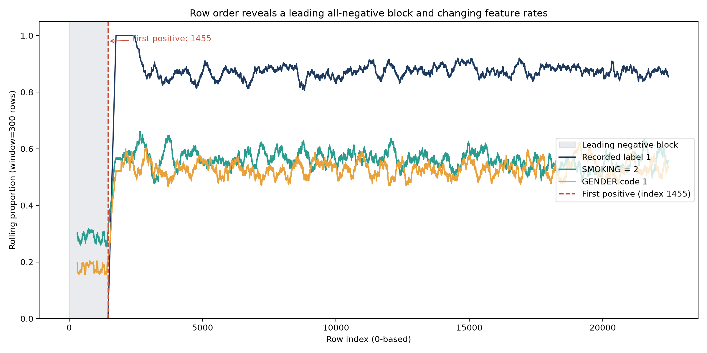
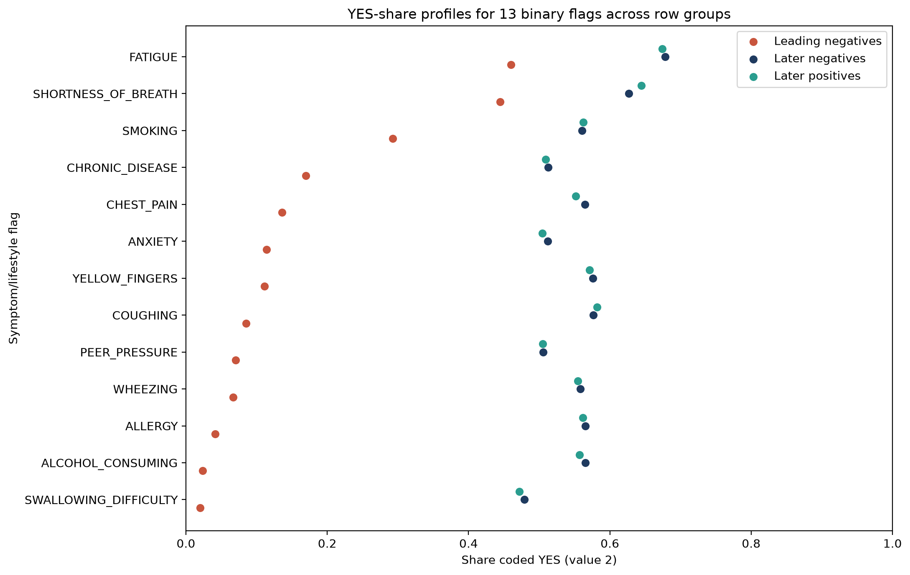
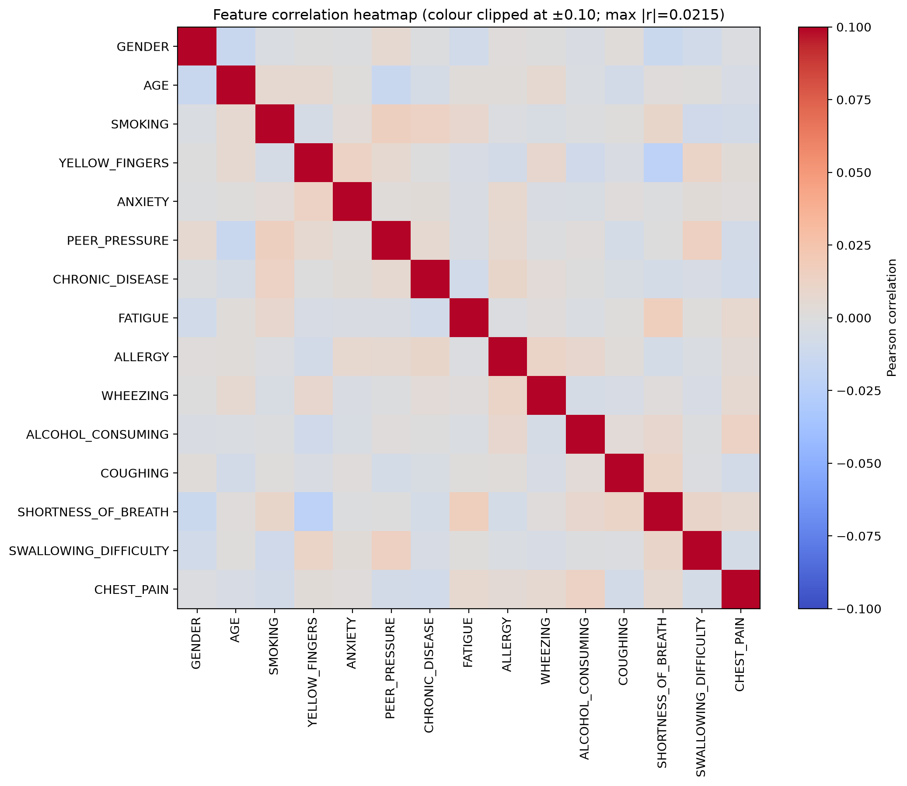
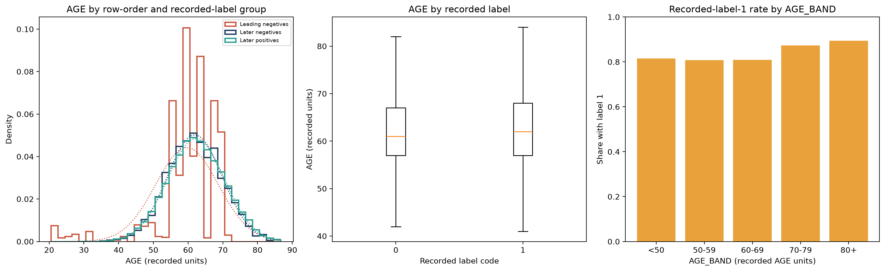
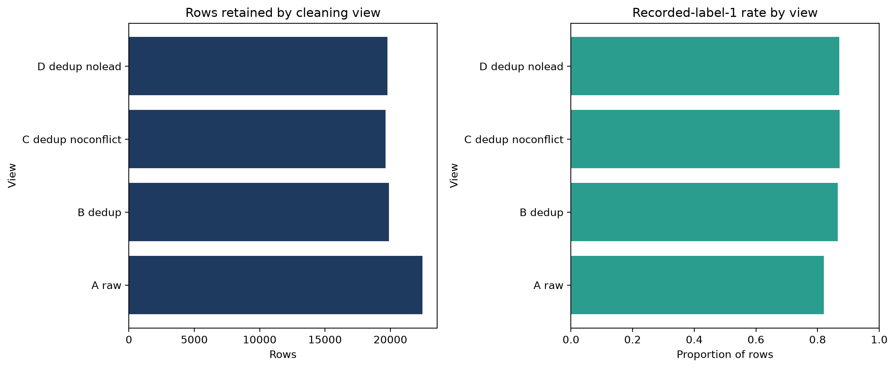
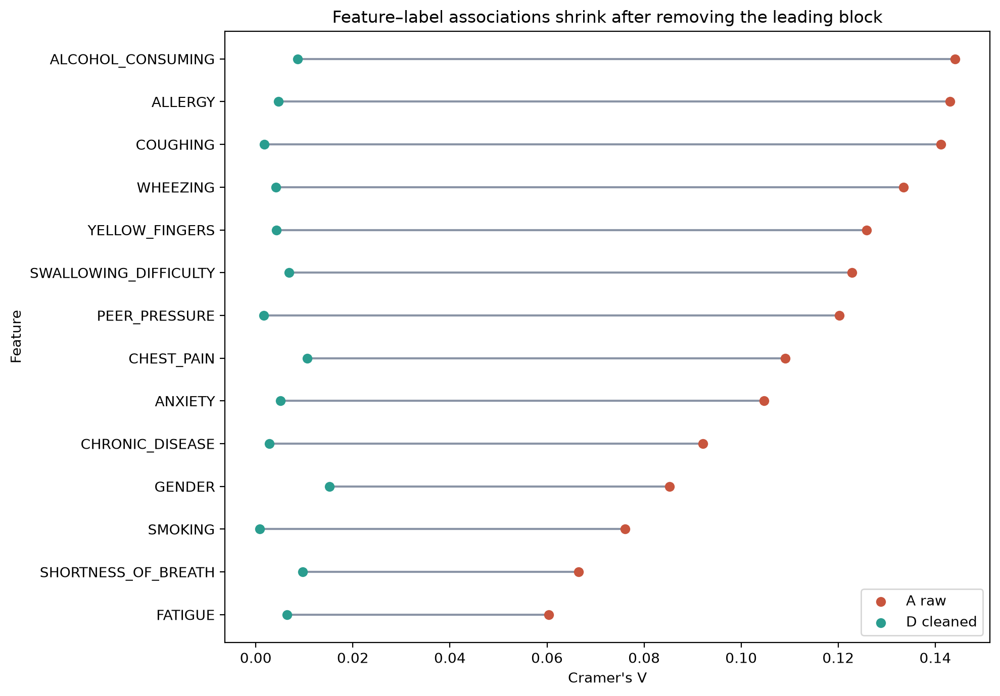
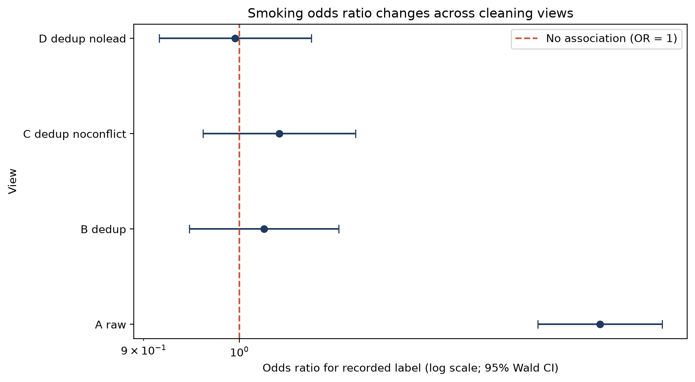

# Lung Cancer Risk Project: Integrity Audit and Descriptive Analysis

**Coursework research prototype. Not a diagnostic or screening tool.**

## Abstract

This report examines whether a survey-style file supports stable descriptive associations with its recorded label after integrity problems are addressed. The supplied file contains 22,457 rows and 17 columns; the recorded positive-label share is 82.1%. We audited order, duplicates, conflicting patterns, source shifts, and sensitivity to four cleaning views, then calculated pre-specified effect sizes and multiple-testing-adjusted results. The first 1,455 records are all coded negative, and the deduplicated, leading-block-removed view has 19,781 rows. In that view, the smoking-label odds ratio is 1.00 (95% CI 0.92 to 1.08; p=0.911), while the minimum adjusted q-value for the feature family is 0.46. These findings describe this file, not a population or an individual. Source, licence, label meaning, and gender-code mapping remain unknown, and the supplied checksum differs from the project contract. No predictive model was fitted. This is a research prototype, not a diagnostic or screening tool.

## 1. Business understanding

Lung-cancer screening guidance is intended for a defined population and requires more history than a yes/no smoking item. The 2021 U.S. Preventive Services Task Force recommendation applies to adults aged 50 to 80 years with at least 20 pack-years who currently smoke or stopped within the past 15 years [1]. The supplied file has an age field and a coded smoking flag, but no pack-years, smoking duration, or quit-time measure. As a result, the file cannot reproduce those eligibility criteria. Published work on risk-based screening likewise provides context for why a single binary flag is not a complete risk history [2]. That context motivates careful data understanding; it does not validate this file.
The project question is whether the observed associations are robust to integrity-aware treatment, not whether a model can assign clinical risk. The business objective is therefore to characterize the supplied data, document uncertainty, and provide reproducible outputs that a reviewer can inspect. A trivial accuracy benchmark would be misleading: the label is imbalanced, so an always-positive rule has accuracy 82.1% without learning any structure. That number is an arithmetic baseline, not a trained model or meaningful success criterion.
Five research questions guide the work. RQ1 asks which integrity problems occur and how large they are. RQ2 asks what associations with the recorded label remain after the planned treatments. RQ3 asks how sensitive the results are to cleaning policy. RQ4 asks what is known about representativeness. RQ5 asks which derived descriptors can be justified from the available fields. The work succeeds when the input shape and schema are checked, each treatment is reproducible, estimates include effect sizes and uncertainty, and all claims are traceable to generated tables or figures. It does not set a target for predictive performance.
The scope follows a data-understanding and data-preparation workflow. It includes descriptive statistics, source-shift diagnostics, sensitivity views, pre-specified tests, and feature specifications. It excludes clinical interpretation of the label, causal claims, external validation, and model training. The dataset's provenance is not established, so there is no defensible sampling frame from which to estimate population representativeness. The positive label share is high, but the project cannot determine whether this reflects sampling, synthetic construction, a particular case-control design, or another process. The report's success criteria concern reproducibility and honest limits, not whether the file appears clinically plausible.

## 2. Data understanding

The input CSV has 22,457 observations and 17 columns. It contains 0 null cells; `patient_id` is unique, and the age values span 21 to 87 (mean 62.08, standard deviation 8.28). The row-level schema checks require the expected column order and shape, no nulls, unique identifiers, binary label codes, symptom flags in the supplied 1/2 coding, and a permissive age range. Observed values are distinguished from undocumented meanings: the file's `GENDER` code is reported as `GENDER_CODE`, and `LUNG_CANCER` is called the recorded label, not a verified diagnosis.
The complete column-level dictionary below records type, coding, observed range, and coded-value share. The source description identifies symptom/lifestyle code 1 as NO and code 2 as YES, but it does not explain the gender mapping or how the label was generated. Age is treated as a numeric variable in the supplied units; the unit is presumed to be years based on the values but is not documented. `patient_id` is a sequential identifier and is excluded from feature construction. The raw dictionary is also maintained separately in `docs/data_dictionary.md`.

| Column | Type | Coding | Observed range | Share of YES / code share | Notes |
|---|---|---|---:|---:|---|
| `patient_id` | int64 | Sequential row identifier | 1–22,457 | N/A | Unique in this file; not an analysis feature. |
| `GENDER_CODE` (`GENDER`) | int64 | 0/1; mapping unknown | 0–1 | Code 1: 50.69% | Meaning of each code: unknown. Report as `GENDER_CODE`. |
| `AGE` | int64 | Age; unit presumed years, not documented | 21–87 | N/A | Observed range; unit documentation: unknown. |
| `SMOKING` | int64 | 1 = NO, 2 = YES | 1–2 | 54.46% | Code meaning per supplied project description. |
| `YELLOW_FINGERS` | int64 | 1 = NO, 2 = YES | 1–2 | 54.21% | Code meaning per supplied project description. |
| `ANXIETY` | int64 | 1 = NO, 2 = YES | 1–2 | 48.01% | Code meaning per supplied project description. |
| `PEER_PRESSURE` | int64 | 1 = NO, 2 = YES | 1–2 | 47.68% | Code meaning per supplied project description. |
| `CHRONIC_DISEASE` | int64 | 1 = NO, 2 = YES | 1–2 | 48.73% | Code meaning per supplied project description. |
| `FATIGUE` | int64 | 1 = NO, 2 = YES | 1–2 | 66.05% | Code meaning per supplied project description. |
| `ALLERGY` | int64 | 1 = NO, 2 = YES | 1–2 | 52.85% | Code meaning per supplied project description. |
| `WHEEZING` | int64 | 1 = NO, 2 = YES | 1–2 | 52.33% | Code meaning per supplied project description. |
| `ALCOHOL_CONSUMING` | int64 | 1 = NO, 2 = YES | 1–2 | 52.32% | Code meaning per supplied project description. |
| `COUGHING` | int64 | 1 = NO, 2 = YES | 1–2 | 54.90% | Code meaning per supplied project description. |
| `SHORTNESS_OF_BREATH` | int64 | 1 = NO, 2 = YES | 1–2 | 62.97% | Code meaning per supplied project description. |
| `SWALLOWING_DIFFICULTY` | int64 | 1 = NO, 2 = YES | 1–2 | 44.36% | Code meaning per supplied project description. |
| `CHEST_PAIN` | int64 | 1 = NO, 2 = YES | 1–2 | 52.62% | Code meaning per supplied project description. |
| `LUNG_CANCER` | int64 | 0/1; meaning unknown | 0–1 | Recorded label code 1: 82.09% | The meaning and label-generation process are unknown. |

The checksum is a separate integrity contract. The expected prefix is `4ad2333067fcb0a9`; the supplied file's observed prefix is `1e0d557990cd7533`. The mismatch is documented in `data/raw/CHECKSUMS.txt` and the decision log. The user explicitly approved analysis of this current snapshot under an explicit checksum override; the expected checksum has not been silently changed. Normal loading verifies the contract by default, while the analysis runner emits a warning and opts out explicitly. This does not establish that the input is the same file intended by the original project specification.
The recorded label has 18,434 rows coded 1 and 4,023 coded 0, for a positive-code share of 82.1%. The code meaning and label-generation process are unknown. Because the file's share is likely not representative of a screening population, it cannot be interpreted as population prevalence. The unknown provenance also prevents identification of sampling design, inclusion criteria, consent, or intended use. These are material limitations rather than minor documentation gaps.

## 3. Preprocessing and integrity audit

The most visible ordering issue is a leading block: the first 1,455 rows are all coded negative, and the first positive appears at zero-based row index 1455. The rolling label rate stays at zero through that block and rises after the boundary. The smoking YES share is 29.3% in the leading block and 56.0% among later negative rows. Multiple coded features distinguish those groups. This is consistent with a source or collection-process shift, but the available metadata cannot prove how the groups were assembled.
The file contains 2,573 exact duplicate rows and 2,706 repeated feature patterns when the identifier is ignored. There are 133 feature patterns with conflicting labels involving 315 rows; the most repeated pattern occurs 86 times. In the later portion, 1,352 repeated feature rows were observed, compared with a mean of 614.9 in a seeded independent-marginal simulation. The simulation is a rough diagnostic, not a valid generative model for the unknown source. Its purpose is to show that the duplicate burden deserves review, not to establish intent or authenticity.
The sequential identifier alone has AUC 0.670 for ranking the recorded label. This is an audit statistic demonstrating ordering-related signal, not a model result. Row order, duplicates, and group structure can create misleading train/test separation or cross-validation performance if ignored [3]. Therefore the identifier is excluded from features, and the project does not fit a predictive model. The raw-file-only association is retained as a sensitivity result rather than treated as substantive evidence.
Four views make preprocessing choices explicit. View A retains all raw rows. View B removes exact duplicates while retaining conflicting labels. View C additionally removes rows belonging to conflicting patterns. View D starts from the deduplicated B view and removes all rows whose original raw index is before the first positive label. The last operation is keyed to the raw index, not a position in a deduplicated table; this avoids accidentally discarding or retaining the wrong rows. The views are sensitivity analyses, not claims that any single policy repairs unknown data provenance.

| View | Rows | Positive-code share | Treatment |
| --- | --- | --- | --- |
| A - raw | 22,457 | 82.1% | No row removal |
| B - deduplicated | 19,884 | 86.6% | Keep first exact row |
| C - no conflicts | 19,618 | 87.1% | Also drop conflicting patterns |
| D - no leading block | 19,781 | 87.1% | B, filtered by original index |

Age outlier flags use the descriptive interquartile-range rule: the fences are 40.5 and 84.5, yielding 221 flagged observations. No age rows were removed solely for this flag because the observed values satisfy the broad schema bounds and there is no source documentation establishing measurement errors. This preserves a transparent distinction between a statistical flag and a confirmed invalid record. The four analysis views focus on the observed structural artifacts rather than silently trimming tail values.
The treatment log keeps each decision auditable: preserve a raw baseline; create an exact-deduplicated view; create a no-conflict sensitivity view; and create a deduplicated, leading-block-removed view. No missing-value imputation is needed because the loaded file has no null cells. Identifier removal is part of feature construction, not raw-data rewriting. Encodings are kept as supplied in the audit tables and recoded only in derived feature outputs. These rules reduce avoidable analysis leakage while leaving the original CSV unchanged.

## 4. Exploratory analysis and statistics

The analysis pre-specifies five descriptive hypotheses. H1 compares the recorded label by smoking code using an odds ratio, confidence interval, Pearson chi-square, and seeded permutation test. H2 compares age distributions using Mann-Whitney U and the common-language effect size (CLES). H3 relates a four-item respiratory/chest symptom count to the label using Spearman rho. H4 tests the binary feature family in each view and adjusts p-values with Benjamini-Hochberg (BH), which controls the false discovery rate under its assumptions [4]. H5 compares the leading block with later negative rows as an integrity diagnostic. P-values are not treated as effect sizes or evidence of causation.

### Figure 1. Is the file ordered?

The rolling label rate is zero through the first 1,455 rows, then changes after the first positive label. The plot describes order, not time; there is no documented temporal variable. The boundary is an observed sequence feature and supports treating row order as a potential leakage path.

### Figure 2. Do YES shares differ across the three row groups?

The leading-block negatives have lower YES shares across several flags than later negatives and positives. The latter two profiles are closer overall. These are descriptive contrasts in this file; they do not identify a source or establish that the label is valid.

### Figure 3. Are the later-view features correlated with each other?

The maximum absolute pairwise correlation is 0.022. The clipped scale makes weak values visible; this descriptive heatmap does not prove mutual independence.

### Figure 4. How does AGE vary between the leading block and later rows?

The figure compares the leading block with later negatives and positives, shows AGE by recorded-label code, and summarizes the recorded label by AGE_BAND. Normal overlays are parameterized separately from each group's observed mean and standard deviation; they are descriptive references, not assumptions about the data source.

### Figure 5. How do the four cleaning views change the analysis sample?

The raw view contains 22,457 rows; B, C, and D contain 19,884, 19,618, and 19,781 rows. These are policy-defined sensitivity views, not estimates of a uniquely correct dataset size.

### Figure 6. Do feature associations depend on the cleaning view?

The largest Cramer's V falls from 0.144 in the raw view to 0.015 in view D. In D the smallest raw feature-family p-value is 0.033, but its smallest BH q-value is 0.458. No feature in that adjusted family crosses the conventional threshold. The raw view has 14 of 14 tests below that threshold, underscoring that the apparent associations are sensitive to structural artifacts.

### Figure 7. What is the smoking association across views?

In view A, the smoking odds ratio is 1.49 (95% CI 1.39 to 1.59; p=4.45e-30). In view D it is 1.00 (95% CI 0.92 to 1.08; permutation p=0.908). The raw association is not stable to removal of the ordered block and duplicates; this file does not establish whether smoking has or lacks an association in a valid population.

### Hypothesis results across views

For H1-H3, q-values adjust across the sensitivity views within each hypothesis; H4 q-values adjust the feature family separately in each view; H5 q-values adjust the raw-file integrity feature family. H5 is not repeated across cleaned views because view D removes the leading block being compared.

| View | H1 OR (95% CI) | H1 p / q | H2 CLES (95% CI); p / q | H3 rho (95% CI); p / q | H4 min q |
| --- | --- | --- | --- | --- | --- |
| A_raw | 1.49 (1.39-1.59) | 4.45e-30 / 0.000 | 0.529 (0.521-0.538); 6.72e-09 / 0.000 | 0.191 (0.180-0.207); 3.98e-184 / 0.000 | 0.000 |
| B_dedup | 1.03 (0.95-1.12) | 0.521 / 0.695 | 0.517 (0.504-0.529); 0.005 / 0.007 | 0.015 (0.002-0.029); 0.036 / 0.048 | 0.365 |
| C_dedup_noconflict | 1.04 (0.96-1.14) | 0.304 / 0.609 | 0.519 (0.508-0.530); 0.002 / 0.005 | 0.021 (0.010-0.036); 0.004 / 0.008 | 0.079 |
| D_dedup_nolead | 1.00 (0.92-1.08) | 0.911 / 0.911 | 0.512 (0.500-0.524); 0.051 / 0.051 | -0.002 (-0.017-0.012); 0.773 / 0.773 | 0.458 |

### H5. Do the leading-block negatives differ from later negatives?

H5 is an integrity comparison in the raw file, not a cleaned-view effect: view D removes the leading block and therefore cannot supply this contrast. The following feature-family results compare the leading-block negatives with later negatives; Cramer's V intervals use a row-level multinomial bootstrap, and q-values adjust the 14 feature tests with Benjamini-Hochberg.

| Feature | Chi-square | p | q | Cramer's V (95% CI) |
| --- | --- | --- | --- | --- |
| GENDER | 502.60 | 2.58e-111 | 0.000 | 0.353 (0.324-0.380) |
| SMOKING | 267.40 | 4.18e-60 | 0.000 | 0.258 (0.230-0.290) |
| YELLOW_FINGERS | 830.05 | 1.58e-182 | 0.000 | 0.454 (0.430-0.475) |
| ANXIETY | 632.42 | 1.49e-139 | 0.000 | 0.396 (0.374-0.420) |
| PEER_PRESSURE | 776.94 | 5.57e-171 | 0.000 | 0.439 (0.413-0.462) |
| CHRONIC_DISEASE | 460.08 | 4.62e-102 | 0.000 | 0.338 (0.313-0.362) |
| FATIGUE | 184.74 | 4.47e-42 | 0.000 | 0.214 (0.182-0.245) |
| ALLERGY | 1,086.54 | 2.78e-238 | 0.000 | 0.520 (0.498-0.537) |
| WHEEZING | 952.72 | 3.41e-209 | 0.000 | 0.487 (0.465-0.510) |
| ALCOHOL_CONSUMING | 1,170.17 | 1.85e-256 | 0.000 | 0.539 (0.523-0.558) |
| COUGHING | 934.35 | 3.35e-205 | 0.000 | 0.482 (0.459-0.505) |
| SHORTNESS_OF_BREATH | 125.29 | 4.39e-29 | 0.000 | 0.176 (0.143-0.209) |
| SWALLOWING_DIFFICULTY | 910.22 | 5.89e-200 | 0.000 | 0.476 (0.455-0.493) |
| CHEST_PAIN | 705.36 | 2.05e-155 | 0.000 | 0.419 (0.393-0.443) |

In views B and C, age and respiratory-count tests can be nominally significant, but their effects are small: CLES is 0.517 in B and 0.519 in C, while respiratory-count rho is 0.015 and 0.021. In view D, H2 has p=0.051 and H3 has rho=-0.002 (p=0.773). No association survives the H4 family correction in D, and observed effects are negligible. This wording acknowledges the nominal results rather than claiming that no test was ever significant.
The planned two-group power approximation in view D uses 11,080 smoking-code YES rows and 8,701 NO rows, with alpha 0.05 and target power 0.8. Its approximate minimum detectable risk difference is 0.0135 (1.3%). This is a planning calculation, not evidence that a smaller association is absent. The unusually structured data, unknown sampling process, and dependence among duplicate rows limit the interpretation of nominal inferential quantities.
Across tests, a small p-value indicates incompatibility with a specified null model under its assumptions; it does not measure effect magnitude, causal impact, or clinical value. Conversely, a large p-value is not proof of no association. The goal of the multiple-view analysis is to reveal sensitivity to data handling, not to select whichever view yields a preferred conclusion. H5 is explicitly an integrity check, and its statistically small p-values are expected to accompany the marked differences between the block and later negatives.

## 5. Feature engineering

Feature construction is descriptive preparation for a possible later study; it is not a fitted model. The exported feature tables remove `patient_id`, keep the recorded label in a separate column, recode symptom/lifestyle fields from 1/2 to 0/1, and rename `GENDER` to `GENDER_CODE` without guessing its meaning. The feature specification is driven by simple, inspectable transformations.

| Feature | Definition | Type / range | Rationale | Leakage note |
|---|---|---|---|---|
| `GENDER_CODE` | Original `GENDER` code, unchanged | Binary 0/1 | Preserve supplied coded variable without guessing its meaning | Not a verified demographic interpretation |
| `AGE` | Original age field | Numeric; observed 21–87 | Preserve recorded age | Units are undocumented |
| Each original symptom/lifestyle flag | Code 2 → 1; code 1 → 0 | Binary 0/1 | Consistent numerical representation of supplied coding | Derived only from the corresponding input flag |
| `AGE_Z` | `(AGE - fitted_mean) / fitted_population_sd` | Numeric | Standardized age for algorithms sensitive to scale | Fit scaler on training folds only in any future modeling |
| `AGE_BAND` | `<50`, `50-59`, `60-69`, `70-79`, or `80+` | Ordered categorical | Descriptive age strata | Cut points are fixed; no label information used |
| `IN_SCREEN_AGE` | 1 when AGE is from 50 through 80 inclusive | Binary 0/1 | Descriptive age-range indicator based on cited screening criteria | Not an eligibility determination; no dose or quit-time fields |
| `RESP_SYMPTOM_COUNT` | Sum of YES recodes for cough, wheezing, shortness of breath, and chest pain | Integer 0–4 | Compact descriptive count of four respiratory/chest symptoms | Input-only summary; not label-derived |
| `SYMPTOM_COUNT_ALL` | Sum of respiratory flags plus fatigue and swallowing difficulty | Integer 0–6 | Broader descriptive symptom count | Input-only summary; not label-derived |
| `SMOKER_IN_SCREEN_AGE` | Recode of smoking YES multiplied by `IN_SCREEN_AGE` | Binary 0/1 | Domain-prior interaction proxy | Not screening eligibility; pack-years and quit time are absent |

The respiratory count sums four recorded yes/no flags and has support from 0 through 4. In view B its distribution is 0: 663, 1: 3,416, 2: 7,110, 3: 6,426, 4: 2,269. The broader symptom count spans 0 through 6. `AGE_Z` uses the mean and population standard deviation fitted on view B for this descriptive export only. Any future cross-validation must fit the scaler inside each training fold to avoid leakage [3]. No log transform is justified by the observed age skew, and the flat PCA spectrum provides no obvious compression target.
The three candidate feature sets contain 15 raw features, 19 raw-plus-engineered features, and 5 prior-driven features. Univariate screening is saved as a descriptive table and is not used to select predictors. Because evidence-based selection is inconclusive after structural treatment, the domain-prior set is retained as a candidate while the other sets remain comparison baselines. `SMOKER_IN_SCREEN_AGE` is only a proxy: age and a binary smoking code do not encode pack-years or time since quitting, so it must not be described as screening eligibility.

## 6. Conclusions and next steps

RQ1 is answered by the audit: the first 1,455 rows are all negative-coded; 2,573 exact duplicates and 133 conflicting feature patterns occur; the identifier AUC is 0.67. RQ2 is answered cautiously: after removing the block, the observed feature-label effects are small and the adjusted family results do not cross the chosen threshold. RQ3 is answered by the changing estimates across A-D; in particular the smoking odds ratio changes from the raw view toward the null in D. These results show sensitivity to cleaning, not a universal biological conclusion.
RQ4 cannot be answered as a population-representativeness question because the source, sampling frame, and collection process are unknown. The high recorded positive-code share is not a population prevalence estimate. RQ5 yields a transparent set of candidate descriptors, but no evidence-based feature-selection claim. The project does not establish causation, diagnostic utility, an individual risk estimate, or the authenticity of the underlying records.
Material limitations include unknown provenance and licence; undocumented label meaning and generation; unknown `GENDER` mapping; no smoking dose, duration, or quit time; a checksum mismatch; possible source shift, duplicates, and row-order structure; a potentially nonrepresentative label balance; and no external validation. The analysis can characterize the supplied file only. The source license must be established before redistribution. The checksum override is explicit and should be replaced with a verified intended file if one becomes available.
The next project phase, if authorized, is planned rather than implemented: confirm provenance and label semantics, obtain a documented sampling frame, define an appropriate cohort, then design leakage-safe evaluation with grouped or source-aware splits and clinically meaningful metrics. A later model should be evaluated on independent, representative data with calibration and uncertainty analysis. No such model experiment was run here because the coursework scope excludes model fitting. A model score from the current file would not resolve its integrity uncertainty.
Reproduction uses the repository environment, raw-file contract, pipeline runner, result generator, report and slide builders, and tests. From the project root: create and activate a virtual environment; install `requirements.txt`; run `python -m src.run_analysis`; run `python -m src.results`; build the report and slides; then run `python -m pytest -q`. Generated results are intended to come from the checked-in code, not manual transcription. A clean-clone run and presentation rehearsal remain external delivery tasks.

## References

[1] Screening for Lung Cancer: US Preventive Services Task Force Recommendation Statement. U.S. Preventive Services Task Force; JAMA, 2021; 325(10):962-970. https://doi.org/10.1001/jama.2021.1117.

[2] Tammemagi MC et al. Selection Criteria for Lung-Cancer Screening. New England Journal of Medicine, 2013; 368(8):728-736. https://doi.org/10.1056/NEJMoa1211776.

[3] Kapoor S, Narayanan A. Leakage and the reproducibility crisis in machine-learning-based science. Patterns, 2023; 4(9):100804. https://doi.org/10.1016/j.patter.2023.100804.

[4] Benjamini Y, Hochberg Y. Controlling the False Discovery Rate: A Practical and Powerful Approach to Multiple Testing. Journal of the Royal Statistical Society: Series B, 1995; 57(1):289-300. https://doi.org/10.1111/j.2517-6161.1995.tb02031.x.

## Reproducibility

1. Create and activate the project virtual environment.
2. Install the pinned packages from `requirements.txt`.
3. Run `python -m src.run_analysis`.
4. Run `python -m src.results`, `python -m src.build_report`, and `python -m src.build_slides`.
5. Run `python -m pytest -q`.
